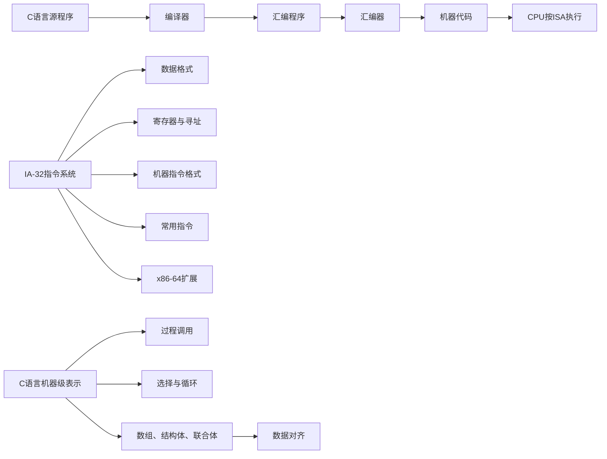
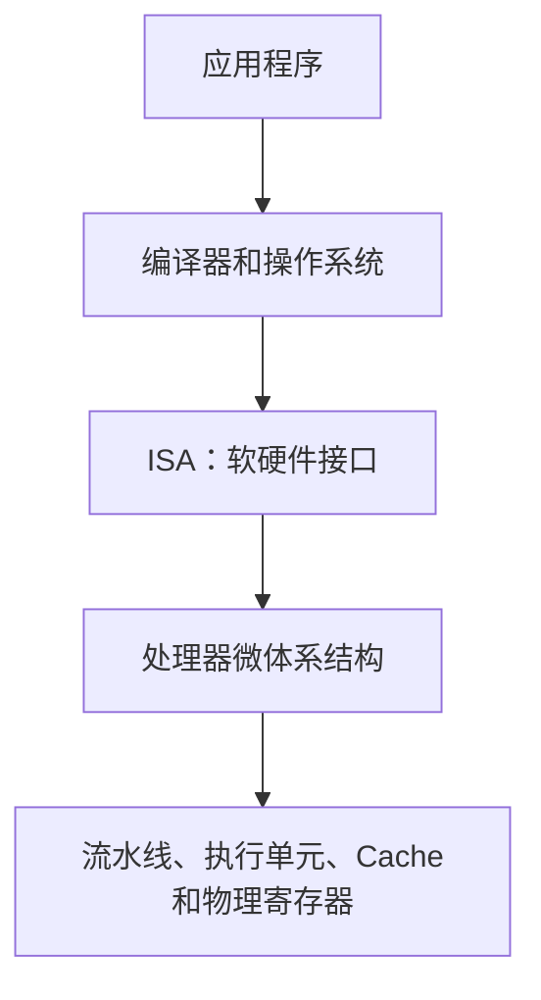
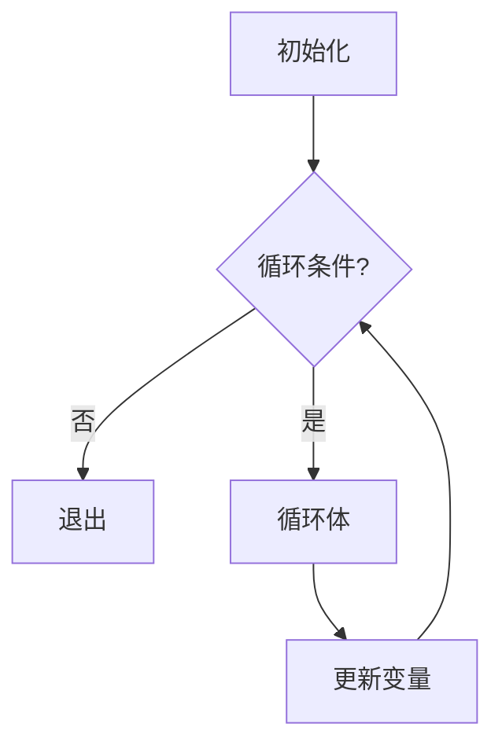
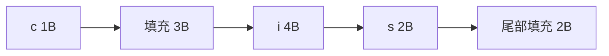
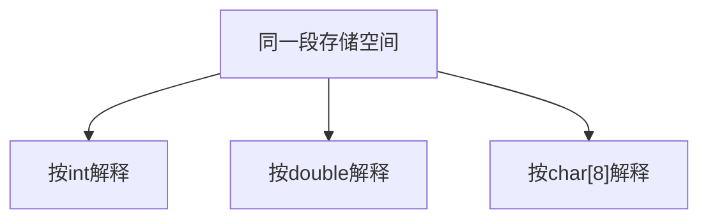
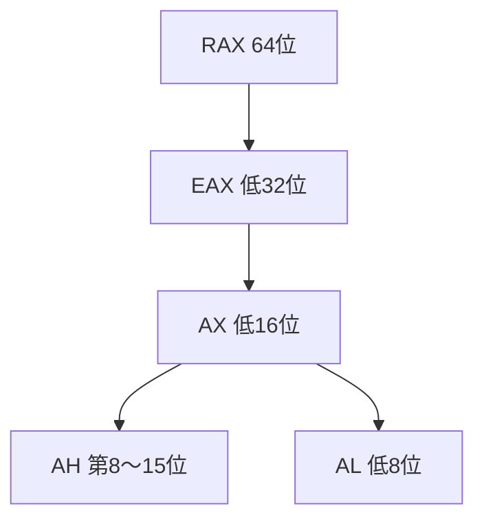

## 程序的转换及机器级表示 {#程序的转换及机器级表示}


## 本章学习地图 {#本章学习地图}



本章有三条核心主线：

1.  ****程序转换主线**** ：高级语言如何经过编译、汇编而变为机器代码。
2.  ****指令系统主线**** ：一条指令怎样表示“做什么、对谁做、数据在哪里”。
3.  ****高级结构降级主线**** ：函数、条件、循环和复杂数据如何落到寄存器、存储器、栈和跳转指令上。

教材使用寄存器传送语言RTL(Register Transport language)描述指令功能。本讲义采用如下简化记号：

-   `R[eax]` ：寄存器EAX的内容。
-   `M[addr]` ：从地址 `addr` 开始的存储单元内容。
-   `R[eax] <- M[R[ebp]+4]` ：把 `EBP+4` 所指内存中的数据送入EAX。

本文章使用IA-32指令集,AT&amp;T语法格式演示

同一个指令集拥有是不同的语法，但它们都会正确的翻译成对应的目标硬件的机器码。具体知识请查看[架构]()

在Intel语法中，靠括号[]来区分内存（mov eax, [ebx]），寄存器直接写。
在AT&amp;T语法中，靠前缀%来区分寄存器（movl (%ebx), %eax），内存靠括号。

---


### 1 程序转换概述 {#1-程序转换概述}


#### 1.1 机器指令及汇编指令 {#1-dot-1-机器指令及汇编指令}

<!--list-separator-->

-  核心概念

    机器指令是处理器能够直接识别和执行的二进制编码，通常包含：

    -   ****操作码**** ：规定传送、加法、比较、跳转等操作。
    -   ****操作数信息**** ：规定数据来源和结果去向。
    -   ****寻址信息**** ：规定如何计算存储器地址。
    -   ****立即数或位移量**** ：直接编码在指令中的常数。

    汇编指令用助记符、寄存器名、变量名和标号表示机器指令，使程序可供人阅读。例如：

    ```asm
    addl %ebx, %eax
    ```

    其RTL语义为：

    ```text
    R[eax] <- R[eax] + R[ebx]
    ```

    汇编语言和机器语言高度对应，但不能把二者完全等同：标签、数据定义和对齐命令不一定对应可执行指令；伪指令也可能被展开为多条真实指令。

<!--list-separator-->

-  示例：两个整数相加

    ```C
    int add(int a, int b) {
        return a + b;
    }
    ```

    一种IA-32实现：

    ```asm
    add:
        movl 4(%esp), %eax
        addl 8(%esp), %eax
        ret
    ```

    -   `4(%esp)` 处是第一个参数。
    -   `8(%esp)` 处是第二个参数。
    -   返回值放在 `%eax` 中。
    -   `ret` 从栈中取得返回地址并返回调用者。

    <!--listend-->

    ```mermaid
    flowchart LR
        A["C表达式 a+b"] --> B["汇编：mov/add"]
        B --> C["二进制机器指令"]
        C --> D["CPU取指、译码、执行"]
    ```

<!--list-separator-->

-  补充与易错点

    -   CPU直接执行的是机器代码，不是文本形式的汇编文件。
    -   反汇编可以从机器代码得到汇编形式，但通常不能恢复变量名、类型、注释和原始控制结构。
    -   汇编语言依赖ISA；x86、ARM和RISC-V的汇编不能直接互换。
    -   同一机器指令可以有Intel格式和AT&amp;T格式两种文本表示。


#### 1.2 指令集体系结构 {#1-dot-2-指令集体系结构}

指令集体系结构ISA是软件与硬件之间的接口规范。编译器按照ISA生成机器代码，处理器则负责正确实现这些指令的语义。



<!--list-separator-->

-  ISA通常规定

    -   程序可使用的指令及其编码。
    -   程序可见寄存器。
    -   数据类型和操作数长度。
    -   寻址方式和存储器访问规则。
    -   条件码、异常和中断的体系结构机制。
    -   指令执行后程序可观察到的结果。

<!--list-separator-->

-  ISA通常不规定

    -   流水线级数。
    -   Cache容量和替换策略。
    -   是否乱序执行。
    -   一条指令内部被拆成多少微操作。
    -   处理器的具体电路结构。

    这些属于 ****微体系结构**** 。两款处理器可以实现相同的x86-64 ISA，却采用完全不同的流水线、缓存和分支预测结构，从而具有不同的性能和功耗。

<!--list-separator-->

-  示例

    同一个x86-64可执行程序可运行在多个厂商、多个代次的兼容处理器上，原因不是它们内部结构相同，而是它们对外都遵守相同ISA和相应ABI。

<!--list-separator-->

-  补充

    ISA还不是完整的二进制兼容规则。操作系统、编译器和库通常还遵守ABI，进一步规定参数传递、寄存器保存、数据布局和目标文件格式。


#### 3.1.3 指令系统设计风格 {#3-dot-1-dot-3-指令系统设计风格}

指令系统常用CISC和RISC两种设计倾向进行说明。

| 对比点 | CISC倾向     | RISC倾向             |
|-----|------------|--------------------|
| 指令长度 | 可变、形式丰富 | 通常较规则           |
| 寻址方式 | 较丰富       | 较少且规则           |
| 存储器操作 | 多类指令可带存储器操作数 | 强调load/store访存   |
| 译码  | 较复杂       | 相对简单             |
| 代码密度 | 通常较高     | 与指令宽度和压缩扩展有关 |
| 代表  | x86/IA-32    | ARM、RISC-V、LoongArch |

<!--list-separator-->

-  示例：实现 `c=a+b`

    装入-存储型指令系统可抽象为：

    ```asm
    load  r1, [a]
    load  r2, [b]
    add   r3, r1, r2
    store [c], r3
    ```

    IA-32允许算术指令的一个操作数位于存储器中：

    ```asm
    movl a, %eax
    addl b, %eax
    movl %eax, c
    ```

    但IA-32的普通 `mov` 通常仍不允许存储器到存储器的直接复制，需用寄存器中转。

<!--list-separator-->

-  现代处理器中的融合

    ```mermaid
    flowchart LR
        A["复杂x86指令"] --> B["前端译码"]
        B --> C["内部微操作"]
        C --> D["调度与乱序执行"]
        D --> E["执行单元"]
    ```

    现代x86处理器对外保持CISC形式，对内常把复杂指令转换成较简单的微操作。因此“RISC一定比CISC快”并不成立；性能还取决于实现、缓存、编译器和工作负载。


#### 3.1.4 生成机器代码的过程 {#3-dot-1-dot-4-生成机器代码的过程}


<!--list-separator-->

-  预处理

    处理 `#include` 、 `#define` 和条件编译。例如：

    ```C
    #define DOUBLE(x) ((x) + (x))
    int y = DOUBLE(a);
    ```

    会被展开为近似：

    ```C
    int y = ((a) + (a));
    ```

    宏是文本替换，参数若带副作用可能被求值多次。

<!--list-separator-->

-  编译

    编译器完成词法和语法分析、类型检查、中间代码生成、优化和目标汇编生成。

    ```C
    int square(int x) { return x * x; }
    ```

    可能得到：

    ```nil
    movl 4(%esp), %eax
    imull %eax, %eax
    ret
    ```

<!--list-separator-->

-  汇编

    汇编器把助记符转换为机器编码，建立符号表，为尚未确定的外部地址生成重定位信息，并输出目标文件。

<!--list-separator-->

-  优化的影响

    优化后可能发生函数内联、常量折叠、无用代码删除、循环展开和寄存器分配。因此一条C语句没有固定的汇编指令数量。

    观察代码可使用：

    ```bash
    gcc -m32 -O0 -S example.c -o example_O0.s
    gcc -m32 -O2 -S example.c -o example_O2.s
    objdump -d example.o
    ```

    ---


### 3.2 IA-32指令系统概述 {#3-dot-2-ia-32指令系统概述}


#### 3.2.1 数据类型及其格式 {#3-dot-2-dot-1-数据类型及其格式}

IA-32指令主要按操作数宽度处理位串。位串本身不携带“有符号、无符号、地址”等标签，具体含义由指令和程序类型决定。

| 名称        | 位数 | 字节数 | AT&amp;T后缀    |
|-----------|----|-----|---------------|
| Byte        | 8  | 1   | `b`             |
| Word        | 16 | 2   | `w`             |
| Double word | 32 | 4   | `l`             |
| Quad word   | 64 | 8   | `q` ，主要见于x86-64 |

<!--list-separator-->

-  同一位串的不同解释

    8位 `11111111` ：

    -   无符号解释为255。
    -   补码有符号解释为-1。

    因此有符号比较和无符号比较必须使用不同条件跳转。

<!--list-separator-->

-  小端存储

    若 `int x=0x12345678` 从地址 `0x1000` 开始存放：

    ```text
    0x1000: 78
    0x1001: 56
    0x1002: 34
    0x1003: 12
    ```

    ```mermaid
    flowchart LR
        A["低地址 0x1000<br/>78"] --> B["0x1001<br/>56"]
        B --> C["0x1002<br/>34"]
        C --> D["高地址 0x1003<br/>12"]
    ```

<!--list-separator-->

-  扩展

    `0xFF` 从8位扩展到32位：

    ```text
    零扩展：0x000000FF = 255
    符号扩展：0xFFFFFFFF = -1
    ```

    ```asm
    movzbl %al, %eax
    movsbl %al, %eax
    ```

    易错点： `word` 在IA-32术语中是16位；扩展有符号负数时若误用零扩展，数值会改变。


#### 3.2.2 寄存器组织和寻址方式 {#3-dot-2-dot-2-寄存器组织和寻址方式}

<!--list-separator-->

-  程序可见寄存器

    | 寄存器 | 传统用途   |
    |-----|--------|
    | `%eax` | 累加器、函数返回值 |
    | `%ebx` | 基址、被调用者保存 |
    | `%ecx` | 计数、移位次数 |
    | `%edx` | 乘除法扩展部分、数据 |
    | `%esi` | 源变址     |
    | `%edi` | 目的变址   |
    | `%ebp` | 栈帧基址   |
    | `%esp` | 栈顶指针   |

    此外：

    -   `EIP` 保存下一条指令地址。
    -   `EFLAGS` 保存条件码和控制标志。
    -   段寄存器参与IA-32分段机制。

    <!--listend-->

    ```mermaid
    flowchart TB
        EAX["EAX：32位"] --> AX["AX：低16位"]
        AX --> AH["AH：第8～15位"]
        AX --> AL["AL：低8位"]
    ```

<!--list-separator-->

-  有效地址

    ```text
    有效地址 = 位移量 + 基址寄存器 + 变址寄存器 × 比例因子
    ```

    比例因子只能为1、2、4、8。AT&amp;T形式为：

    ```asm
    disp(base, index, scale)
    ```

    例如：

    ```asm
    movl 12(%ebp, %ecx, 4), %eax
    ```

    读取地址 `EBP + ECX×4 + 12` 处的4字节。

<!--list-separator-->

-  常见寻址方式

    ```asm
    movl $10, %eax              // 立即寻址
    movl %ebx, %eax             // 寄存器寻址
    movl (%eax), %edx           // 寄存器间接
    movl 8(%ebp), %eax          // 基址加位移
    movl (%eax,%ecx,4), %edx    // 基址+变址×比例
    ```

    若 `%eax` 保存 `int a[]` 的首地址、 `%ecx` 保存下标 `i` ，最后一条指令实现 `edx=a[i]` 。


#### 3.2.3 机器指令格式 {#3-dot-2-dot-3-机器指令格式}

IA-32指令采用1～15字节的可变长度编码，通常由以下部分组成：


-   ****前缀**** ：改变操作数长度、地址长度、重复方式或锁定语义。
-   ****操作码**** ：规定基本操作。
-   ****ModR/M**** ：组合 `mod` 、 `reg/opcode` 和 `r/m` 字段，编码寄存器及寻址方式。
-   ****SIB**** ：组合 `scale` 、 `index` 和 `base` 。
-   ****位移量**** ：地址计算中的常量偏移。
-   ****立即数**** ：作为数据直接编码在指令内。

<!--list-separator-->

-  编码示例

    ```C
    movl 8(%ebp), %eax
    ```

    一种编码为：

    ```text
    8B 45 08
    ```

    -   `8B` ：把32位寄存器或存储器操作数送入寄存器。
    -   `45` ：选择EAX和 `EBP+8位位移` 的寻址组合。
    -   `08` ：位移量8。

    Intel格式 `mov eax,[ebp+8]` 与AT&amp;T格式 `movl 8(%ebp),%eax` 可生成同一机器指令；文本语法不等于机器编码格式。

    ---


### 3.3 IA-32常用指令类型及其操作 {#3-dot-3-ia-32常用指令类型及其操作}


#### 3.3.1 传送指令 {#3-dot-3-dot-1-传送指令}

<!--list-separator-->

-  MOV

    ```asm
    movl source, destination
    ```

    执行 `destination <- source` 。普通 `mov` 不允许两个操作数同时来自存储器：

    ```asm
    movl (%eax), %ecx
    movl %ecx, (%ebx)
    ```

    错误示意：movl (%eax), (%ebx)

<!--list-separator-->

-  LEA

    ```asm
    leal 8(%eax,%ecx,4), %edx
    ```

    只计算 `EAX+ECX×4+8` ，不读取该地址中的内存。编译器也会用 `lea` 执行普通整数运算：

    ```asm
    leal 3(%eax,%eax,4), %edx
    ```

    edx = 5\*eax+3

<!--list-separator-->

-  栈传送

    ```asm
    pushl %eax
    popl %ebx
    ```

    ```text
    pushl: ESP <- ESP-4; M[ESP] <- EAX
    popl:  EBX <- M[ESP]; ESP <- ESP+4
    ```

    ```mermaid
    flowchart LR
        A["push前"] --> B["ESP减4"]
        B --> C["写入新栈顶"]
        C --> D["pop读取栈顶"]
        D --> E["ESP加4"]
    ```

    因为在x86架构中，栈是“向下生长”的（从高地址向低地址扩展）,所以ESP栈顶指针在扩展栈空间时进行“减”运算

    注意： `lea` 与 `mov` 的根本差别是前者不访存； `push/pop` 会隐式修改ESP。


#### 3.3.2 定点算术运算指令 {#3-dot-3-dot-2-定点算术运算指令}

```asm
addl %ebx, %eax
subl %ebx, %eax
incl %eax
decl %eax
negl %eax
cmpl %ebx, %eax
```

`cmp` 执行类似 `EAX-EBX` 的运算，只更新标志而不保存差值。

| 标志 | 含义     |
|----|--------|
| CF | 无符号进位或借位 |
| ZF | 结果为0  |
| SF | 结果符号位 |
| OF | 有符号运算溢出 |

例如8位 `127+1` 得到位串 `10000000` ：按有符号数发生溢出，OF=1；它没有产生第9位进位，CF=0。CF和OF不能混用。

<!--list-separator-->

-  乘法

    ```asm
    mull operand       // EDX:EAX <- EAX * operand，无符号
    imull operand      // 有符号扩展宽度乘法
    imull %ebx, %eax   // EAX <- EAX * EBX
    ```

<!--list-separator-->

-  除法

    ```asm
    divl %ecx          // EDX:EAX无符号除以ECX
    cltd
    idivl %ecx         // EDX:EAX有符号除以ECX
    ```

    商写入EAX，余数写入EDX。无符号除法前通常把EDX清零；有符号除法前通常用 `cltd` 把EAX符号扩展到EDX:EAX。除数为0或商超出范围会触发异常。


#### 3.3.3 按位运算指令 {#3-dot-3-dot-3-按位运算指令}

```asm
andl %ebx, %eax
orl  %ebx, %eax
xorl %ebx, %eax
notl %eax
testl %eax, %eax
```

掩码应用：

```asm
andl $0xFF, %eax          // 保留最低8位
orl  $0x08, %eax          // 把第3位置1
andl $0xFFFFFFF7, %eax    // 把第3位清0
xorl $0x08, %eax          // 翻转第3位
```

`test` 执行按位与并设置条件码，但不保存结果，常用于判断寄存器是否为0。

<!--list-separator-->

-  移位

    ```asm
    shll $1, %eax    // 左移
    shrl $1, %eax    // 逻辑右移，高位补0
    sarl $1, %eax    // 算术右移，高位补符号位
    ```

    对非负整数，左移 `k` 位通常相当于乘 `$2^k$` ；右移与除法在负数舍入、溢出和语言规则上可能有差异。位运算宜优先使用无符号类型。


#### 3.3.4 程序执行流控制指令 {#3-dot-3-dot-4-程序执行流控制指令}

无条件跳转：

```asm
jmp target
```

常用条件跳转：
条件跳转指令Jcc。（其 中 cc 为 条 件 助 记 符 ） 以标志位或标志位组合作为跳转依据。如果满足条件，则跳转到由标号匕卜可确定的目标地址处执行；否则继续执行下一条指令。这类指令都采用 ****相对寻址方式**** 的直接跳转

| 条件  | 指令  | 条件码     |
|-----|-----|---------|
| 相等  | `je`  | ZF=1       |
| 不等  | `jne` | ZF=0       |
| 无符号小于 | `jb`  | CF=1       |
| 无符号大于 | `ja`  | CF=0且ZF=0 |
| 有符号小于 | `jl`  | SF不等于OF |
| 有符号大于 | `jg`  | ZF=0且SF=OF |

| 指令          | 跳转条件       | 说明       |
|-------------|------------|----------|
| jc label      | CF=1           | 有进位 / 借位 |
| jnc label     | CF=0           | 无进位 / 借位 |
| je/jz label   | ZF=1           | 相等 / 等于零 |
| jne/jnz label | ZF=0           | 不相等 / 不等于零 |
| js label      | SF=1           | 是负数     |
| jns label     | SF=0           | 是非负数   |
| jo label      | OF=1           | 有溢出     |
| jno label     | OF=0           | 无溢出     |
| ja/jnbe label | CF=0 AND ZF=0  | 无符号整数 A＞B |
| jae/jnb label | CF=0 OR ZF=1   | 无符号整数 A≥B |
| jb/jnae label | CF=1 AND ZF=0  | 无符号整数 A＜B |
| jbe/jna label | CF=1 OR ZF=1   | 无符号整数 A≤B |
| jg/jnle label | SF=OF AND ZF=0 | 带符号整数 A＞B |
| jge/jnl label | SF=OF OR ZF=1  | 带符号整数 A≥B |
| jl/jnge label | SF≠OF AND ZF=0 | 带符号整数 A＜B |
| jle/jng label | SF≠OF OR ZF=1  | 带符号整数 A≤B |

<!--list-separator-->

-  示例

    ```C
    if (a < b) x=1; else x=0;
    ```

    ```asm
    movl a, %eax
    cmpl b, %eax
    jl .Lless
    movl $0, x
    jmp .Lend
    .Lless:
    movl $1, x
    .Lend:
    ```

    ```mermaid
    flowchart TD
        A["比较a与b"] --> B{"a<b?"}
        B -- 是 --> C["x=1"]
        B -- 否 --> D["x=0"]
        C --> E["继续"]
        D --> E
    ```

    `call` 把返回地址压栈后跳到被调用过程； `ret` 从栈顶取出返回地址。条件跳转依赖之前设置的标志，比较与跳转之间不能随意插入修改标志的指令。

    ---


### 3.4 C语言程序的机器级表示 {#3-dot-4-c语言程序的机器级表示}


#### 3.4.1 过程调用的机器级表示 {#3-dot-4-dot-1-过程调用的机器级表示}

过程调用必须协调参数、返回地址、返回值、寄存器和局部变量。以下采用典型IA-32 cdecl/System V风格：

-   参数通常从右向左压栈。
-   返回值通常在EAX中。
-   调用者清理参数。
-   EAX、ECX、EDX通常由调用者保存。
-   EBX、ESI、EDI、EBP通常由被调用者恢复。

<!--list-separator-->

-  经典栈帧

    ```asm
    pushl %ebp
    movl  %esp, %ebp
    subl  $16, %esp
    ```

    结束时：

    ```asm
    leave
    ret
    ```

    `leave` 近似等于 `movl %ebp,%esp; popl %ebp` 。

    ```mermaid
    flowchart TB
        A["高地址"] --> B["后续参数"]
        B --> C["第一个参数"]
        C --> D["返回地址：4(%ebp)"]
        D --> E["旧EBP：0(%ebp)"]
        E --> F["局部变量：负偏移"]
        F --> G["低地址 / 当前ESP"]
    ```

<!--list-separator-->

-  示例

    ```c
    int add(int a,int b) { return a+b; }
    ```

    调用者：

    ```asm
    pushl $3
    pushl $2
    call add
    addl $8, %esp
    ```

    被调用者：

    ```asm
    add:
        pushl %ebp
        movl %esp, %ebp
        movl 8(%ebp), %eax
        addl 12(%ebp), %eax
        leave
        ret
    ```

    优化器可能省略EBP栈帧、把局部变量保存在寄存器、内联函数或进行尾调用优化。经典栈帧是理解模型，不是所有函数的固定模板。


#### 3.4.2 选择语句的机器级表示 {#3-dot-4-dot-2-选择语句的机器级表示}

<!--list-separator-->

-  if-else

    ```c
    if (x>0) y=x; else y=-x;
    ```

    ```asm
    movl x, %eax
    cmpl $0, %eax
    jle .Lelse
    movl %eax, y
    jmp .Lend
    .Lelse:
    negl %eax
    movl %eax, y
    .Lend:
    ```

<!--list-separator-->

-  逻辑短路

    ```c
    if (p != NULL && p->value > 0)
    ```

    必须先判断 `p` 非空，才可读取 `p->value` 。

    ```mermaid
    flowchart TD
        A{"p非空?"} -- 否 --> D["条件为假"]
        A -- 是 --> B{"p->value>0?"}
        B -- 否 --> D
        B -- 是 --> C["条件为真"]
    ```

<!--list-separator-->

-  switch

    分支少或case稀疏时，可生成连续比较；case密集时，可使用跳转表：

    ```mermaid
    flowchart TD
        A["index=x-min"] --> B{"index越界?"}
        B -- 是 --> C["default"]
        B -- 否 --> D["读取jump_table[index]"]
        D --> E["间接跳转到case"]
    ```

    简单、无副作用的条件表达式还可能使用 `cmov` 条件传送，减少不可预测分支，但两个候选值通常都需要可安全计算。


#### 3.4.3 循环结构的机器级表示 {#3-dot-4-dot-3-循环结构的机器级表示}

`while` 、 `do-while` 和 `for` 最终都由比较、条件跳转和回跳构成。



<!--list-separator-->

-  数组求和

    ```c
    int sum_array(int *a,int n) {
        int sum=0;
        for (int i=0;i<n;i++) sum+=a[i];
        return sum;
    }
    ```

    抽象汇编：

    ```asm
    xorl %eax, %eax              // sum=0
    xorl %ecx, %ecx              // i=0
    .Lloop:
        cmpl n, %ecx
        jge .Ldone
        addl (%edx,%ecx,4), %eax
        incl %ecx
        jmp .Lloop
    .Ldone:
        ret
    ```

    -   `while` 先判断，可能一次都不执行。
    -   `do-while` 先执行，至少一次。
    -   `for` 可理解为初始化、条件、循环体、更新四部分。
    -   `break` 跳向循环出口； `continue` 跳向更新或下一次判断位置。

    编译器还可能进行循环不变量外提、强度削弱、展开、向量化和指针递增优化。

    ---


### 3.5 复杂数据类型的分配和访问 {#3-dot-5-复杂数据类型的分配和访问}


#### 3.5.1 数组的分配和访问 {#3-dot-5-dot-1-数组的分配和访问}

一维数组元素地址：

```text
&A[i] = base(A) + i * sizeof(A[0])
```

例如 `int a[10]` 首地址为 `0x1000` ，则：

```text
&a[3] = 0x1000 + 3*4 = 0x100C
```

```asm
movl (%eax,%ecx,4), %edx
```

可用于读取 `a[i]` 。

<!--list-separator-->

-  二维数组

    C语言按行优先存放 `int a[R][C]` ：

    ```text
    &a[i][j] = base(a) + (i*C+j)*sizeof(int)
    ```

    ```mermaid
    flowchart LR
        A["a[0][0]"] --> B["a[0][1]"]
        B --> C["..."]
        C --> D["a[0][C-1]"]
        D --> E["a[1][0]"]
    ```

    `a[i]` 等价于 `*(a+i)` ，指针加法会自动按元素宽度缩放。普通C数组访问没有自动边界检查；越界会产生未定义行为，并可能破坏其他数据。

    按行连续遍历二维数组通常具有较好的空间局部性。


#### 3.5.2 结构体数据的分配和访问 {#3-dot-5-dot-2-结构体数据的分配和访问}

```c
struct S {
    char c;
    int i;
    short s;
};
```

典型4字节对齐布局：

```text
偏移0：c，1字节
偏移1～3：填充
偏移4～7：i
偏移8～9：s
偏移10～11：尾部填充
总大小：12字节
```



若结构体首地址在EAX， `i` 的偏移为4：

```asm
movl $10, 4(%eax)
```

结构体赋值语义上复制整个对象，编译器可能使用多条传送、块复制指令或库函数。结构体按值传参和返回的具体实现由ABI决定。

成员顺序会影响填充。例如 `char,int,char` 典型大小为12字节，而 `int,char,char` 可能只需8字节；但涉及外部二进制接口时不能随意调整成员顺序。


#### 3.5.3 联合体数据的分配和访问 {#3-dot-5-dot-3-联合体数据的分配和访问}

```c
union U {
    int i;
    double d;
    char bytes[8];
};
```

所有成员共享同一段存储空间。联合体大小至少容纳最大成员，并满足最严格成员的对齐要求。



若写入 `u.i=0x12345678` ，在小端机器观察字节可能得到 `78 56 34 12` 。但跨平台程序不能轻率依赖字节序、类型大小、浮点格式或未初始化剩余字节。

联合体不会自动记录当前有效成员，常配合标签使用：

```c
struct Value {
    enum Kind { INT_VALUE, DOUBLE_VALUE } kind;
    union { int i; double d; } data;
};
```

访问前根据 `kind` 选择正确成员。


#### 3.5.4 数据的对齐方式 {#3-dot-5-dot-4-数据的对齐方式}

若对象要求 `a` 字节对齐，则其地址满足：

```text
address mod a = 0
```

典型自然对齐：

| 类型     | 大小 | 常见对齐 |
|--------|----|------|
| `char`   | 1  | 1    |
| `short`  | 2  | 2    |
| `int`    | 4  | 4    |
| IA-32指针 | 4  | 4    |
| x86-64指针 | 8  | 8    |

结构体有两类填充：

-   成员间填充，使下一个成员正确对齐。
-   尾部填充，使结构体数组中的下一个对象仍对齐。

把地址 `x` 向上调整到2的幂 `a` 的倍数：

```text
aligned = (x+a-1) & ~(a-1)
```

例如13按8字节向上对齐得到16。

编译器的 `packed` 扩展可以减少填充，但可能产生未对齐访问、性能下降或ABI不兼容。外部文件和网络协议更适合逐字段序列化，而不是直接写出本机结构体内存。

---


### 3.6 兼容IA-32的64位系统 {#3-dot-6-兼容ia-32的64位系统}


#### 3.6.1 x86-64的基本特点 {#3-dot-6-dot-1-x86-64的基本特点}

x86-64在兼容x86的基础上扩展了寄存器和地址能力。

-   EAX、EBX等扩展为RAX、RBX等64位寄存器。
-   新增R8～R15，共16个64位通用寄存器。
-   RIP和RSP分别对应64位指令指针和栈指针。
-   支持RIP相对寻址，便于生成位置无关代码。
-   现代ABI主要使用SSE/AVX寄存器处理浮点参数和运算。

<!--listend-->



在x86-64模式下，写32位寄存器会自动清零对应64位寄存器的高32位：

```asm
movl $1, %eax     // RAX变为0x0000000000000001
```

写8位或16位子寄存器通常不会自动清除其余高位。

64位寄存器可保存64位地址，但具体处理器和操作系统不一定实现完整的 `2^64` 字节虚拟或物理地址空间。


#### 3.6.2 x86-64的过程调用 {#3-dot-6-dot-2-x86-64的过程调用}

以下采用教材所述类Unix System V AMD64约定。前6个整数或指针参数通常依次放入：

```text
RDI, RSI, RDX, RCX, R8, R9
```

更多参数放在栈中，整数返回值通常放在RAX，浮点参数和返回值通常使用XMM寄存器。

<!--list-separator-->

-  示例

    ```c
    long add3(long a,long b,long c) { return a+b+c; }
    ```

    ```asm
    add3:
        leaq (%rdi,%rsi), %rax
        addq %rdx, %rax
        ret
    ```

    简单函数因为参数已在寄存器中，可以完全不建立栈帧。

    常见保存责任：

    -   调用者保存：RAX、RCX、RDX、RSI、RDI、R8～R11。
    -   被调用者保存：RBX、RBP、R12～R15。
    -   RSP返回时必须恢复。

    调用边界还要遵守16字节栈对齐要求。

    ```mermaid
    flowchart TD
        A["调用者准备寄存器参数"] --> B["调整栈并保持对齐"]
        B --> C["call压入返回地址"]
        C --> D["被调用者保存必要寄存器"]
        D --> E["执行函数体"]
        E --> F["恢复寄存器和RSP"]
        F --> G["ret返回"]
    ```

    Windows x64调用约定与System V不同，不能把上述参数寄存器规则直接套用到Windows目标程序。


#### 3.6.3 x86-64的基本指令和对齐 {#3-dot-6-dot-3-x86-64的基本指令和对齐}

64位操作常用 `q` 后缀：

```asm
movq %rdi, %rax
addq %rsi, %rax
subq $8, %rsp
```

不同宽度转换：

```asm
movl   %edi, %eax      // 写EAX并清RAX高32位
movslq %edi, %rax      // 32位有符号扩展到64位
movzbq %dil, %rax      // 8位零扩展到64位
```

地址计算：

```asm
leaq 8(%rdi,%rsi,4), %rax
```

执行 `RAX=RDI+RSI×4+8` ，不访问内存。

在常见Linux LP64模型中， `int` 为4字节， `long` 和指针为8字节；Windows x64常采用LLP64， `long` 仍为4字节。跨平台程序不应假设 `long` 总和指针同宽。

<!--list-separator-->

-  64位结构布局示例

    ```c
    struct Node {
        char tag;
        void *next;
        int value;
    };
    ```

    典型布局为： `tag` 偏移0，填充7字节， `next` 偏移8， `value` 偏移16，尾部填充4字节，总大小24字节。调整为 `pointer,int,char` 后，典型大小可能降为16字节。

<!--list-separator-->

-  从IA-32迁移到x86-64的风险

    -   用 `int` 保存指针导致截断。
    -   使用错误的格式串输出指针或64位整数。
    -   假设 `sizeof(long)==4` 。
    -   依赖32位结构体偏移。
    -   内联汇编继续使用旧调用约定。
    -   忽视16字节栈对齐。

    保存指针的整数表示宜使用 `uintptr_t` 或 `intptr_t` 。

    ---


### 本章总结 {#本章总结}

| 高级语言结构    | 机器级实现基础           |
|-----------|-------------------|
| 变量赋值        | 数据传送                 |
| 算术表达式      | 算术、逻辑和移位指令     |
| 指针访问        | 地址计算和存储器访问     |
| `if` / `switch` | 比较、条件跳转、条件传送或跳转表 |
| `while` / `for` | 条件测试和回跳           |
| 函数调用        | 参数、寄存器、栈、 `call` 和 `ret` |
| 数组            | 首地址+下标×元素宽度     |
| 结构体          | 对象基址+固定成员偏移    |
| 联合体          | 多个成员共享同一存储空间 |
| x86-64过程      | 寄存器传参、64位寄存器和对齐规则 |

程序的机器级表示不是逐字翻译，而是编译器在ISA和ABI约束下完成以下工作：

1.  选择能够实现源程序语义的指令。
2.  安排寄存器、栈和内存位置。
3.  按数据类型计算宽度、地址和对齐。
4.  把高级控制结构转换成控制流图。
5.  在不改变可观察语义的前提下进行优化。


### 综合自测 {#综合自测}

1.  机器指令、汇编指令和汇编伪指令有什么区别？
2.  ISA与微体系结构分别规定哪些内容？
3.  为什么不能简单断言RISC一定比CISC快？
4.  `movl 8(%ebp),%eax` 的源操作数在哪里？
5.  `lea` 和 `mov` 在是否访存方面有何区别？
6.  CF和OF分别反映哪种溢出？
7.  有符号小于和无符号小于为何使用不同跳转指令？
8.  `call` 和 `ret` 如何利用栈保存返回位置？
9.  二维数组 `a[i][j]` 的地址怎样计算？
10. 为什么结构体既有成员间填充又有尾部填充？
11. 联合体与结构体的存储分配有何区别？
12. 为什么x86-64中写EAX会影响整个RAX？
13. System V x86-64的前6个整数参数通常位于哪些寄存器？
14. 32位程序迁移到64位时，为什么不能使用 `int` 保存指针？
15. 为什么同一段C程序在 `-O0` 和 `-O2` 下可能产生差异很大的汇编代码？


### 推荐实践 {#推荐实践}

```c
struct Item {
    char tag;
    int value;
};

int sum_positive(struct Item *a, int n) {
    int sum = 0;
    for (int i = 0; i < n; i++) {
        if (a[i].value > 0)
            sum += a[i].value;
    }
    return sum;
}
```

分别生成未优化和优化汇编：

~ ~ ~ bash
gcc -m32 -O0 -S test.c -o test_O0.s
gcc -m32 -O2 -S test.c -o test_O2.s
~ ~ ~

重点观察：

-   参数怎样取得。
-   `struct Item` 的大小及 `value` 偏移。
-   数组元素地址怎样计算。
-   循环和条件分别对应哪些跳转。
-   `sum` 和 `i` 位于栈还是寄存器。
-   优化后是否省略栈帧、合并分支或改变循环结构。
