## 一、存储器概述 {#一-存储器概述}


### 1.1 存储器的分类 {#1-dot-1-存储器的分类}


#### 按存储介质 {#按存储介质}

| 类型   | 特点        | 典型产品      |
|------|-----------|-----------|
| 半导体存储器 | 速度快、体积小、功耗低 | RAM、ROM、Flash |
| 磁表面存储器 | 容量大、价格低、速度慢 | 硬盘、磁带    |
| 光存储器 | 容量大、可长期保存 | CD、DVD、蓝光 |


#### 按存取方式 {#按存取方式}

| 类型      | 特点         | 示例                  |
|---------|------------|---------------------|
| 随机存取（RAM） | 随机读写，时间与地址无关 | SRAM、DRAM            |
| 只读（ROM） | 只能读（或写入受限） | Mask ROM、EPROM、EEPROM |
| 顺序存取（SAM） | 按顺序访问   | 磁带                  |
| 直接存取（DAM） | 先定位区域再顺序查找 | 磁盘                  |


### 1.2 主存储器的组成 {#1-dot-2-主存储器的组成}

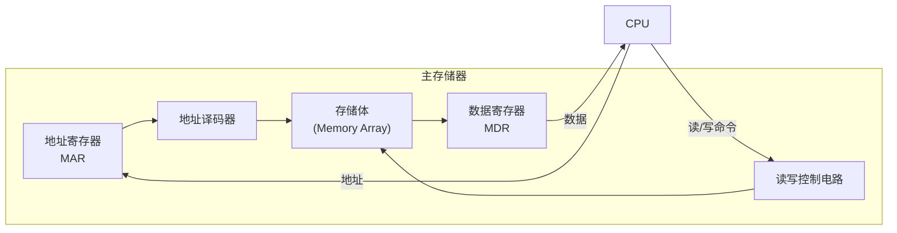

**读操作** ：CPU 送地址 → MAR → 译码 → 选中单元 → 数据读出到 MDR → CPU 取走
**写操作** ：CPU 送地址到 MAR、数据到 MDR → 发写信号 → 写入指定单元


### 1.3 存储器层次化结构 {#1-dot-3-存储器层次化结构}

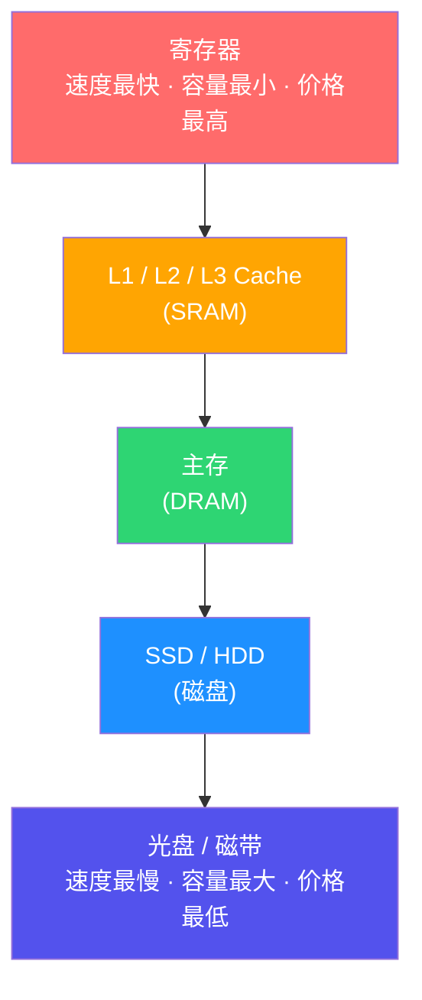

**设计思想** ：上层是下层的缓存，利用局部性原理，在速度、容量、价格之间取得平衡。


### 1.4 程序访问的局部性 {#1-dot-4-程序访问的局部性}

| 类型      | 含义             | 示例        |
|---------|----------------|-----------|
| **时间局部性** | 最近访问的信息不久后再次访问 | 循环体指令、循环变量 |
| **空间局部性** | 访问某单元后，附近单元也会被访问 | 顺序执行指令、数组遍历 |

---


## 二、主存与 CPU 的连接 {#二-主存与-cpu-的连接}


### 2.1 SRAM 与 DRAM {#2-dot-1-sram-与-dram}

| 特性 | SRAM  | DRAM   |
|----|-------|--------|
| 存储原理 | 触发器 | 电容   |
| 是否刷新 | 不需要 | 需要定期刷新 |
| 速度 | 快    | 较慢   |
| 集成度 | 低    | 高     |
| 价格 | 高    | 低     |
| 用途 | Cache | 主存   |


### 2.2 DRAM 刷新方式 {#2-dot-2-dram-刷新方式}

| 刷新方式 | 说明       | 特点      |
|------|----------|---------|
| 集中刷新 | 间隔内集中刷新所有行 | 有死时间  |
| 分散刷新 | 每个周期后刷新一行 | 无死时间，速度降低 |
| 异步刷新 | 间隔内均匀刷新 | 折中，常用 |


### 2.3 现代 DRAM 演进 {#2-dot-3-现代-dram-演进}

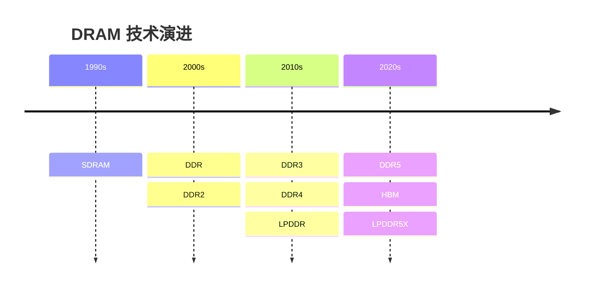


### 2.4 主存容量扩展 {#2-dot-4-主存容量扩展}

-   **位扩展** ：增加数据宽度（多片并联数据线）
-   **字扩展** ：增加单元数量（高位地址译码产生片选）
-   **字位同时扩展** ：两者结合


### 2.5 Load/Store 指令的操作过程 {#2-dot-5-load-store-指令的操作过程}

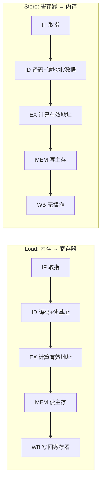

---


## 三、硬盘存储器 {#三-硬盘存储器}


### 3.1 磁盘结构 {#3-dot-1-磁盘结构}

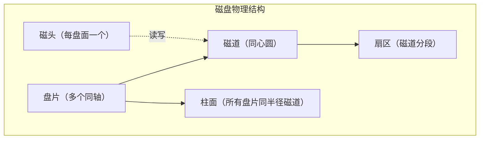

**磁盘地址** ：柱面号 · 磁头号 · 扇区号


### 3.2 磁盘访问时间 {#3-dot-2-磁盘访问时间}

```text
访问时间 = 寻道时间 + 旋转延迟 + 传输时间
```

| 组成 | 说明       | 典型值（7200rpm） |
|----|----------|--------------|
| 寻道时间 | 磁头移到目标磁道 | 5–10 ms      |
| 旋转延迟 | 等待目标扇区转到磁头 | 平均 `4.17 ms` |
| 传输时间 | 实际读写数据 | 通常很短     |

> 平均旋转延迟 = 60 / (2 × 转速 rpm) 秒


### 3.3 SSD 固态硬盘 {#3-dot-3-ssd-固态硬盘}

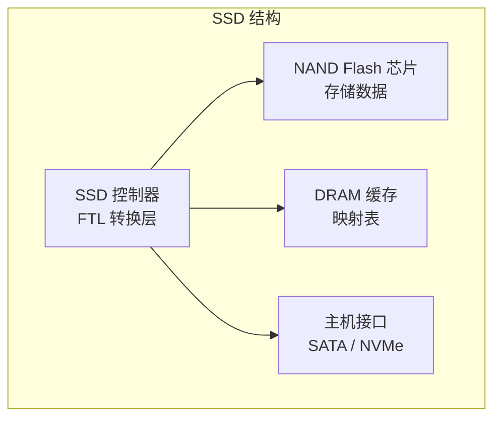

**NAND 类型对比** ：

| 类型 | 单元位数 | 寿命 | 成本 |
|----|------|----|----|
| SLC | 1 bit | 最长 | 最高 |
| MLC | 2 bit | 中等 | 中等 |
| TLC | 3 bit | 较短 | 较低 |
| QLC | 4 bit | 最短 | 最低 |

**SSD 关键技术** ：磨损均衡（Wear Leveling）、垃圾回收（GC）、TRIM 命令、FTL（闪存转换层）。

---


## 四、高速缓冲存储器（Cache） {#四-高速缓冲存储器-cache}


### 4.1 Cache 工作原理 {#4-dot-1-cache-工作原理}

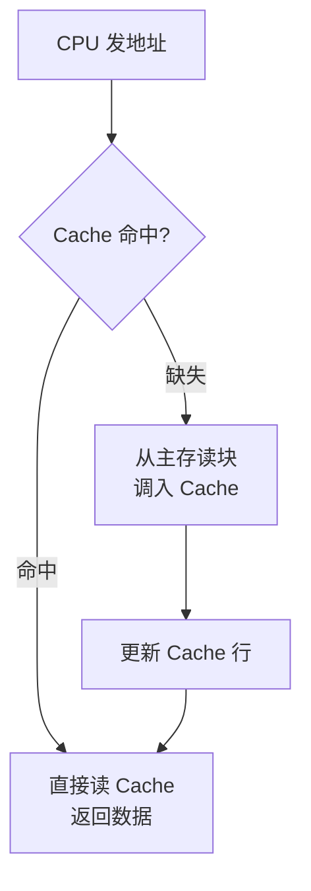

**关键指标** ：

-   **命中率** ：访问命中 Cache 的比例
-   **平均访问时间** = 命中率 × 命中时间 + 缺失率 × (命中时间 + 缺失代价)


### 4.2 三种映射方式 {#4-dot-2-三种映射方式}

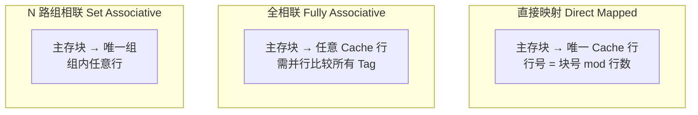

| 映射方式 | 冲突缺失 | 硬件复杂度 | 命中时间 |
|------|------|-------|------|
| 直接映射 | 最高 | 最低  | 最短 |
| 组相联 | 中等 | 中等  | 中等 |
| 全相联 | 最低 | 最高  | 最长 |


### 4.3 地址结构（以直接映射为例） {#4-dot-3-地址结构-以直接映射为例}

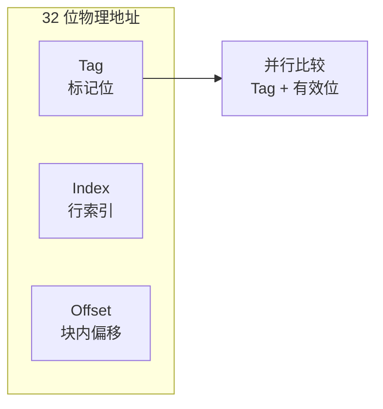


### 4.4 替换算法与写策略 {#4-dot-4-替换算法与写策略}

**替换算法** ：

| 算法  | 思想   | 特点      |
|-----|------|---------|
| 随机  | 随机选行 | 简单，性能一般 |
| FIFO  | 替换最早调入 | 可能换掉常用数据 |
| LRU   | 替换最久未用 | 命中率高，硬件复杂 |
| Clock | 近似 LRU | 实现简单，常用 |

**写策略** ：

| 策略               | 说明                      |
|------------------|-------------------------|
| 写直达（Write Through） | 同时写 Cache 和主存，一致性好但慢 |
| 写回（Write Back） | 只写 Cache，替换时才写回主存，快但可能不一致 |
| 写分配             | 写缺失时先调入 Cache      |
| 非写分配           | 写缺失时直接写主存        |


### 4.5 三类 Cache 缺失（3C 模型） {#4-dot-5-三类-cache-缺失-3c-模型}

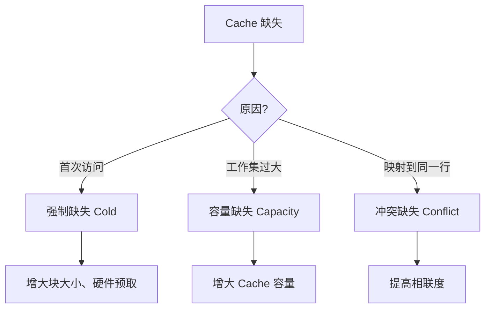

---


## 五、虚拟存储器 {#五-虚拟存储器}


### 5.1 虚拟存储器概述 {#5-dot-1-虚拟存储器概述}

虚拟存储器为每个进程提供独立、连续、巨大的虚拟地址空间，通过 MMU 将虚拟地址映射为物理地址。

**与 Cache 的对比** ：

| 特性 | Cache             | 虚拟存储器       |
|----|-------------------|-------------|
| 目标 | 弥补 CPU 与主存速度差 | 弥补主存与磁盘容量差 |
| 管理方 | 硬件              | OS + 硬件（MMU/TLB） |
| 块大小 | 16–128 B（Cache 行） | 4KB–2MB（页面）  |
| 缺失代价 | `100 ns` （访主存） | `10 ms` （访磁盘） |
| 透明性 | 完全透明          | 缺页由 OS 处理   |


### 5.2 地址翻译过程 {#5-dot-2-地址翻译过程}

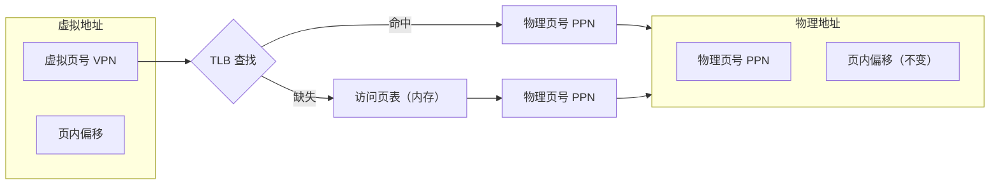


### 5.3 缺页异常处理 {#5-dot-3-缺页异常处理}

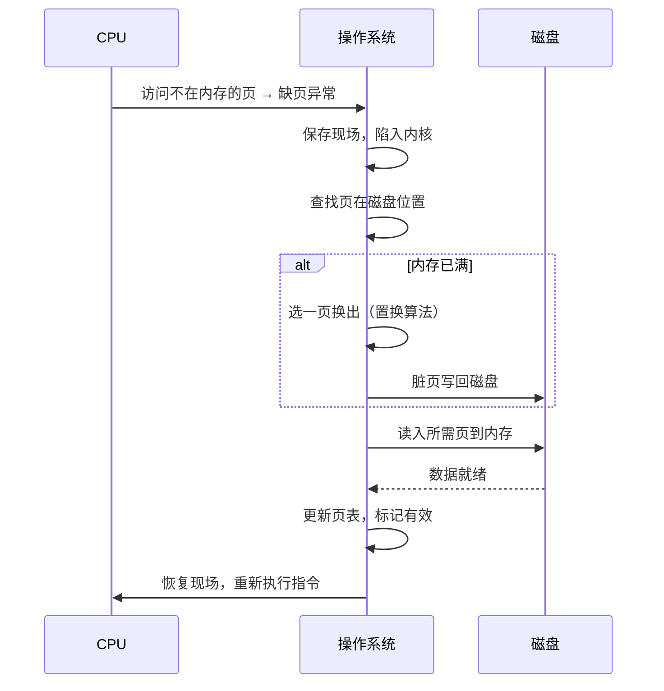


### 5.4 多级页表（x86-64 四级页表） {#5-dot-4-多级页表-x86-64-四级页表}

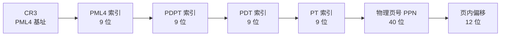

**优点** ：不需要为未使用的页表分配内存，节省空间。


### 5.5 存储保护 {#5-dot-5-存储保护}

每个 PTE 包含保护位：

| 位       | 含义        |
|---------|-----------|
| Valid    | 页面是否在内存 |
| R/W      | 读/写权限   |
| U/S      | 用户/管理员态 |
| Dirty    | 是否被修改  |
| Accessed | 是否被访问  |
| NX       | 是否禁止执行（防攻击） |

---


## 六、现代技术扩展 {#六-现代技术扩展}


### 6.1 新型存储技术 {#6-dot-1-新型存储技术}

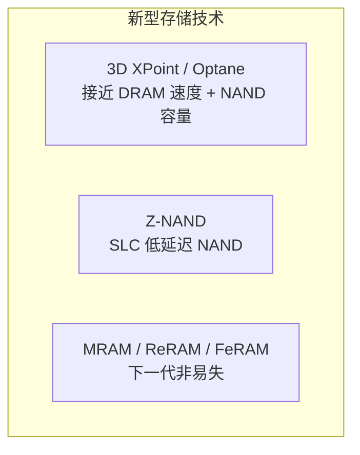


### 6.2 CXL（Compute Express Link） {#6-dot-2-cxl-compute-express-link}

-   基于 PCIe 5.0 的缓存一致性互连
-   支持内存池化（Memory Pooling），多设备共享内存
-   适用于 AI、高性能计算


### 6.3 Cache 优化技术 {#6-dot-3-cache-优化技术}

-   **硬件预取** ：流预取器、步长预取器，自动提前加载
-   **非时序访问（NT）** ：只访问一次的数据绕过 Cache
-   **Intel CAT** ：L3 Cache 分区，防止"吵闹邻居"


### 6.4 大页与 THP {#6-dot-4-大页与-thp}

-   传统 4KB 页 → TLB 命中率低
-   大页（2MB/1GB）→ 减少 TLB 缺失
-   **THP（透明大页）** ：OS 自动合并小页为大页
-   适用：数据库、JVM 堆等内存密集型应用


### 6.5 存算一体 {#6-dot-5-存算一体}


---


## 七、本章练习题 {#七-本章练习题}


### 一、单项选择题 {#一-单项选择题}

1.  "最近访问的数据不久后可能再次被访问"属于？
    -   A. 空间局部性
    -   B. 时间局部性
    -   C. 顺序局部性
    -   D. 分支局部性

2.  需要定期刷新的存储器是？
    -   A. SRAM
    -   B. DRAM
    -   C. Flash
    -   D. ROM

3.  磁盘访问时间不包括？
    -   A. 寻道时间
    -   B. 旋转延迟
    -   C. 传输时间
    -   D. 译码时间

4.  直接映射 Cache 中，主存块映射到？
    -   A. 任意行
    -   B. 固定唯一行
    -   C. 固定组内任意行
    -   D. OS 决定

5.  写回（Write Back）策略特点是？
    -   A. 每次写都更新主存
    -   B. 只写 Cache，替换时才写回
    -   C. 写缺失不调入 Cache
    -   D. 不需要脏位

6.  虚拟存储器页面大小通常为？
    -   A. 64 B
    -   B. 512 B
    -   C. 4 KB
    -   D. 1 MB

7.  TLB 的作用是？
    -   A. 缓存数据
    -   B. 加速地址翻译
    -   C. 存页表
    -   D. 管理交换区

8.  哪种置换算法可能出现 Belady 异常？
    -   A. LRU
    -   B. Clock
    -   C. FIFO
    -   D. 工作集


### 二、简答题 {#二-简答题}

1.  简述存储器层次化结构的设计思想及理论依据。

2.  比较 SRAM 和 DRAM 的特点及应用场景。

3.  说明三种 Cache 映射方式的优缺点。

4.  什么是缺页异常？简述处理过程。

5.  虚拟存储器有哪些优点？与 Cache 有何异同？


### 三、综合应用题 {#三-综合应用题}

1.  某 32 位系统，Cache 32KB，块大小 64B：
    -   (1) 直接映射下 Tag、Index、Offset 各几位？
    -   (2) 8 路组相联下 Tag、Index、Offset 各几位？
    -   (3) 地址 0x12345678 在直接映射下映射到哪行？

2.  某磁盘 4 盘片（8 面），每面 10000 磁道，每道 1000 扇区，每扇区 512B，7200rpm，平均寻道 5ms：
    -   (1) 格式化容量？
    -   (2) 平均旋转延迟？
    -   (3) 读 1MB 连续文件大约时间？

3.  某系统 4KB 页，物理内存 256MB，虚拟地址 4GB：
    -   (1) 页表多少条目？每个 PTE 至少多少位？
    -   (2) 两级页表下两级索引各几位？
    -   (3) TLB 命中率 95%，TLB 1ns，访存 50ns，平均翻译时间？

---


## 参考答案 {#参考答案}


### 选择题 {#选择题}

1.  B  2. B  3. D  4. B  5. B  6. C  7. B  8. C


### 简答题要点 {#简答题要点}

1.  利用局部性原理，上层是下层缓存，在速度/容量/价格间平衡。
2.  SRAM 触发器不刷新、快、贵，用于 Cache；DRAM 电容需刷新、集成度高、便宜，用于主存。
3.  直接映射硬件简单但冲突多；全相联冲突少但硬件复杂；组相联折中。
4.  访问页不在内存时触发，OS 从磁盘调入，更新页表后重新执行。
5.  优点：扩大地址空间、内存保护、共享、简化管理。与 Cache 都是层次存储，但管理方、块大小、缺失代价不同。
