## 一、I/O 子系统概述 {#一-i-o-子系统概述}

### 1.1 什么是 I/O {#1-dot-1-什么是-i-o}

**I/O（输入/输出）** 是计算机与外部设备之间交换信息的过程：

-   **输入** ：键盘输入、磁盘读、网络收包
-   **输出** ：显示器输出、磁盘写、网络发包

### 1.2 I/O 系统层次结构 {#1-dot-2-i-o-系统层次结构}

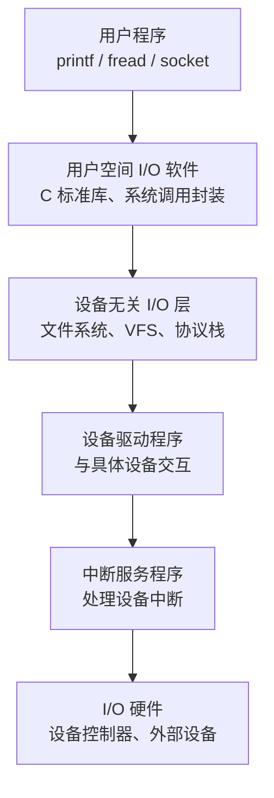

### 1.3 三种 I/O 控制方式 {#1-dot-3-三种-i-o-控制方式}

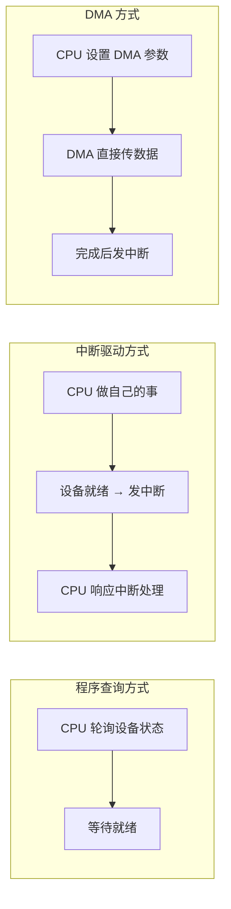

| 方式 | CPU 干预    | 适用场景 |
|----|-----------|------|
| 程序查询 | 最多（轮询等待） | 简单、低速设备 |
| 中断驱动 | 中等（中断时处理） | 中速设备 |
| DMA  | 最少（仅初始化和完成） | 高速大块数据传输 |

---

## 二、用户空间 I/O 软件 {#二-用户空间-i-o-软件}

### 2.1 系统级 I/O vs 标准 I/O {#2-dot-1-系统级-i-o-vs-标准-i-o}

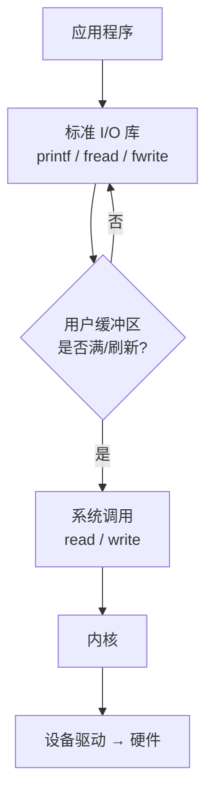

| 类型    | 函数                                | 缓冲  | 系统调用次数 |
|-------|-----------------------------------|-----|--------|
| 系统级 I/O | `open` / `read` / `write` / `close` | 无缓冲 | 每次调用一次 |
| 标准 I/O | `fopen` / `fread` / `fwrite`        | 用户态缓冲 | 缓冲满才调用 |

### 2.2 文件描述符 {#2-dot-2-文件描述符}

在 Unix/Linux 中， **一切皆文件** ：普通文件、目录、设备、管道、Socket、符号链接。

进程启动时默认打开三个文件描述符：

| 描述符 | 名称         | 流向    |
|-----|------------|-------|
| 0   | stdin（标准输入） | 键盘 → 程序 |
| 1   | stdout（标准输出） | 程序 → 屏幕 |
| 2   | stderr（标准错误） | 程序 → 屏幕 |

### 2.3 标准 I/O 的缓冲类型 {#2-dot-3-标准-i-o-的缓冲类型}

| 缓冲类型 | 触发条件     | 示例      |
|------|----------|---------|
| 全缓冲 | 缓冲区满才实际 I/O | 普通文件  |
| 行缓冲 | 遇到换行符才实际 I/O | 终端 stdout |
| 无缓冲 | 每次都实际 I/O | stderr    |

---

## 三、内核空间 I/O 软件 {#三-内核空间-i-o-软件}

### 3.1 设备无关 I/O 层 {#3-dot-1-设备无关-i-o-层}

通过 **VFS（虚拟文件系统）** 提供统一接口：

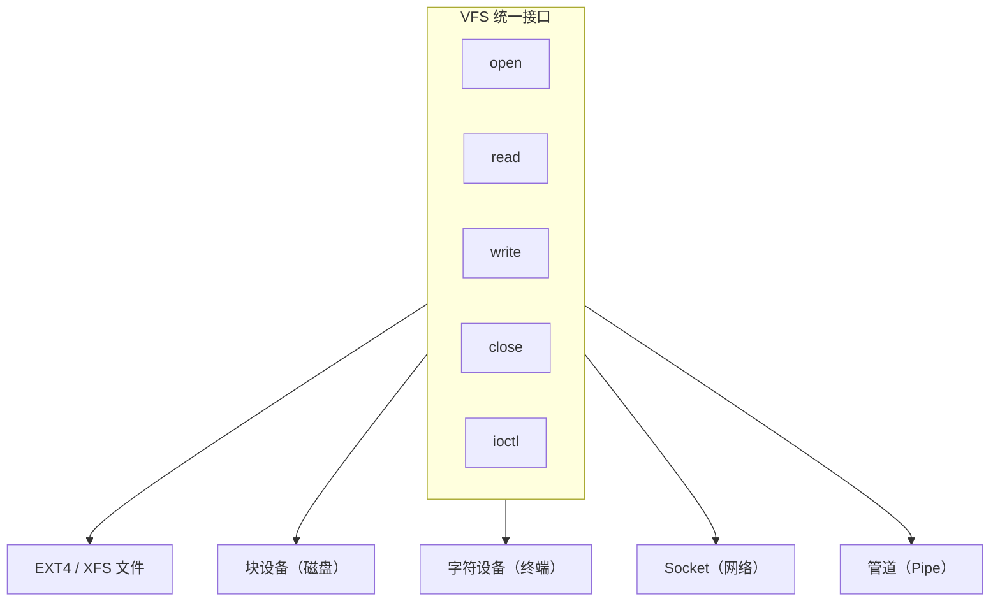

### 3.2 设备分类与驱动 {#3-dot-2-设备分类与驱动}

| 类型 | 访问方式 | 示例     |
|----|------|--------|
| 字符设备 | 按字节流顺序访问 | 键盘、串口、终端 |
| 块设备 | 按块随机访问 | 磁盘、SSD |
| 网络设备 | 面向数据包 | 网卡     |

**驱动加载方式** ：

-   静态编译进内核
-   动态加载（ `.ko` 模块）： `insmod` / `modprobe`

### 3.3 中断上半部与下半部 {#3-dot-3-中断上半部与下半部}

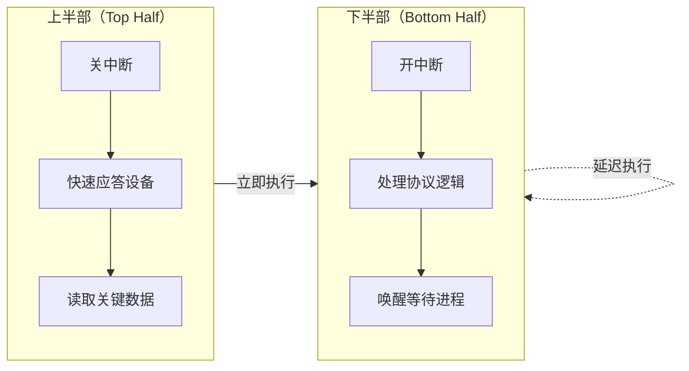

| 机制            | 特点    |
|---------------|-------|
| 软中断（softirq） | 可并发，性能高 |
| tasklet         | 串行执行，简单 |
| 工作队列（workqueue） | 可睡眠，最灵活 |

---

## 四、I/O 硬件与软件接口 {#四-i-o-硬件与软件接口}

### 4.1 总线互连结构 {#4-dot-1-总线互连结构}

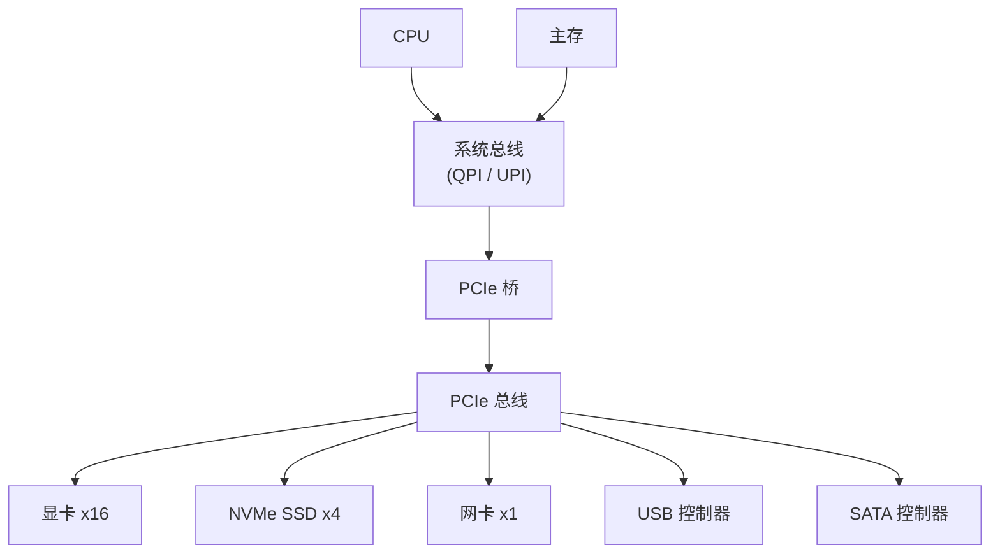

### 4.2 I/O 接口的寄存器 {#4-dot-2-i-o-接口的寄存器}

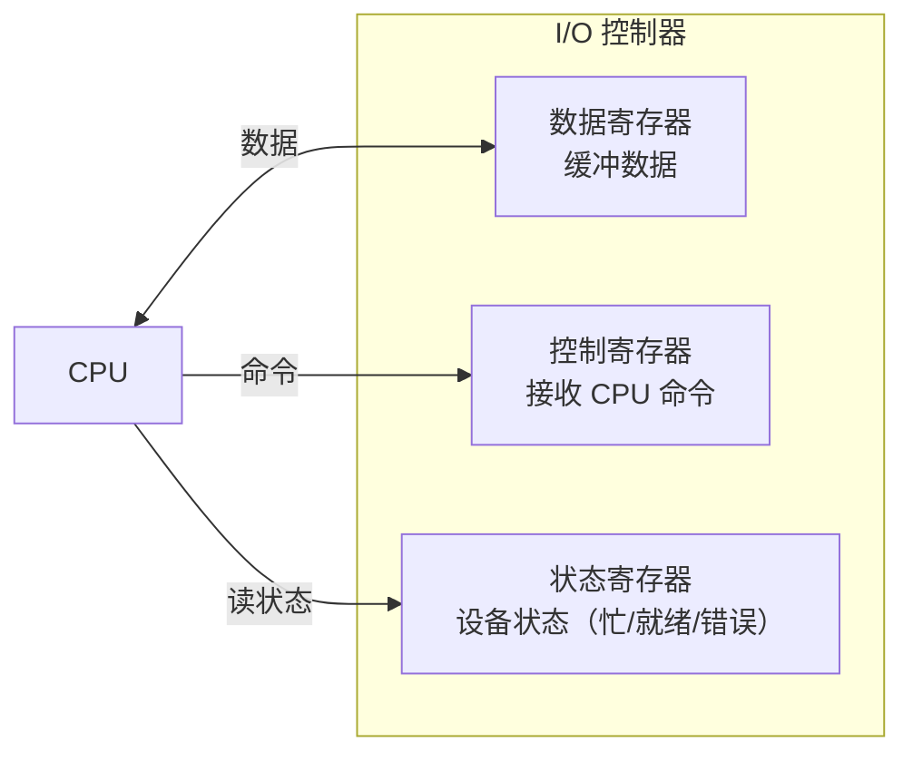

### 4.3 两种 I/O 编址方式 {#4-dot-3-两种-i-o-编址方式}

| 编址方式   | 说明         | 访问指令          | 代表架构        |
|--------|------------|---------------|-------------|
| 独立编址   | I/O 端口独立地址空间 | `in` / `out` 专用指令 | x86             |
| 统一编址（MMIO） | 端口映射到内存地址空间 | 普通访存指令      | ARM、MIPS、RISC-V |

### 4.4 中断系统 {#4-dot-4-中断系统}

**现代中断控制器** ：

-   **APIC** ：Local APIC（每核一个）+ I/O APIC（设备中断路由）
-   **MSI/MSI-X** ：写内存地址触发中断，无需引脚
-   **中断亲和性** ：将中断绑定到指定 CPU 核

---

## 五、现代技术扩展 {#五-现代技术扩展}

### 5.1 io_uring：新一代异步 I/O {#5-dot-1-io-uring-新一代异步-i-o}

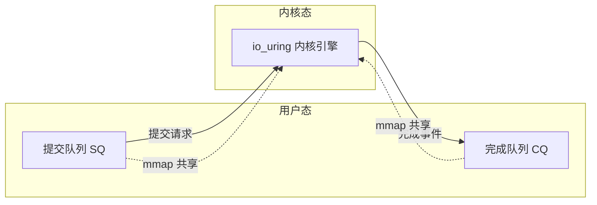

-   Linux 5.1+ 引入，两个共享环形缓冲区
-   **无需系统调用** 即可提交 I/O（mmap 共享）
-   支持文件、网络、定时器等所有 I/O 类型
-   性能远超 epoll + 线程池

### 5.2 零拷贝技术 {#5-dot-2-零拷贝技术}

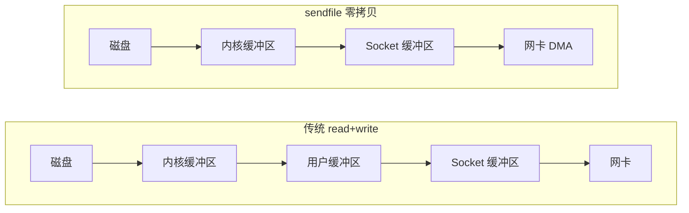

| 技术       | 原理              |
|----------|-----------------|
| `mmap`     | 文件映射到用户空间，减少一次拷贝 |
| `sendfile` | 内核内直接从文件传到 socket |
| `splice`   | 两个 fd 间零拷贝数据移动 |
| DMA        | 网卡直接从内存取数据 |

### 5.3 高性能网络 I/O {#5-dot-3-高性能网络-i-o}

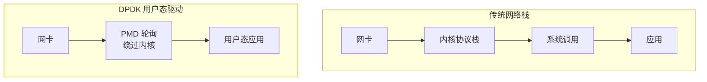

-   **DPDK** ：绕过内核协议栈，用户态直接驱动网卡，PMD 轮询模式
-   **RDMA** ：远程直接内存访问，零内核参与，超低延迟
-   **XDP** ：在网卡驱动层（协议栈前）运行 eBPF 程序，极速包处理

### 5.4 eBPF：内核可编程 {#5-dot-4-ebpf-内核可编程}

-   不修改内核代码、不加载内核模块，即可在内核运行沙箱程序
-   应用：网络过滤、性能分析、安全监控、可观测性
-   工具：bpftrace、BCC、Cilium

### 5.5 NVMe 与现代存储 {#5-dot-5-nvme-与现代存储}

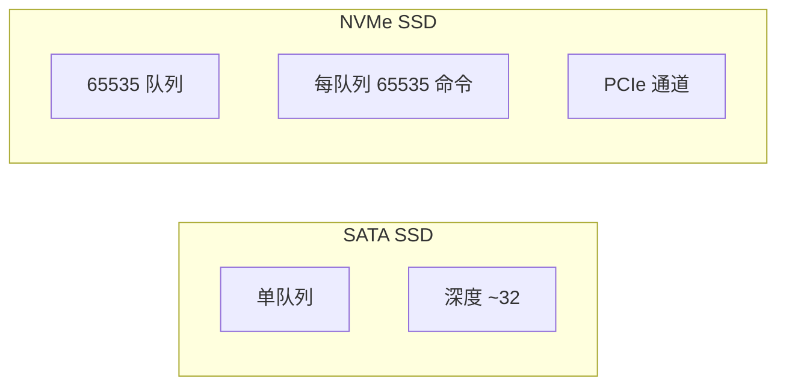

-   **NVMe** ：基于 PCIe，多队列并行，延迟远低于 SATA
-   **NVMe-oF** ：通过网络（RoCE/TCP）访问远程 NVMe
-   **IO 调度器** ：SSD 用 NOOP/NONE，HDD 用 Deadline/CFQ

### 5.6 设备虚拟化 {#5-dot-6-设备虚拟化}

| 方案            | 原理              | 性能 |
|---------------|-----------------|----|
| 全虚拟化        | QEMU 模拟设备     | 慢   |
| 半虚拟化（virtio） | Guest 用 virtio 驱动 | 中   |
| 直通（Passthrough） | 物理设备分给 VM   | 接近原生 |
| SR-IOV          | 一个物理设备虚拟多个 VF | 接近原生 |

---

## 六、本章练习题 {#六-本章练习题}

### 一、单项选择题 {#一-单项选择题}

1.  Unix/Linux 标准输入的文件描述符是？
    -   A. 0
    -   B. 1
    -   C. 2
    -   D. 3

2.  CPU 干预最少的 I/O 方式是？
    -   A. 程序查询
    -   B. 中断驱动
    -   C. DMA
    -   D. 一样

3.  终端 stdout 通常使用哪种缓冲？
    -   A. 全缓冲
    -   B. 行缓冲
    -   C. 无缓冲
    -   D. 单字节

4.  x86 的 I/O 端口编址方式是？
    -   A. 统一编址
    -   B. 独立编址
    -   C. 混合编址
    -   D. 段式编址

5.  以下哪个是字符设备？
    -   A. 磁盘
    -   B. SSD
    -   C. 网卡
    -   D. 键盘

6.  Linux 中断处理中，紧急快速完成的部分是？
    -   A. 下半部
    -   B. 上半部
    -   C. tasklet
    -   D. 工作队列

7.  PCIe 属于哪种总线？
    -   A. 片内总线
    -   B. 系统总线
    -   C. I/O 总线
    -   D. 前端总线

8.  io_uring 的核心数据结构是？
    -   A. 链表
    -   B. 环形缓冲区
    -   C. 红黑树
    -   D. 哈希表

### 二、简答题 {#二-简答题}

1.  比较程序查询、中断驱动、DMA 三种 I/O 控制方式。

2.  系统级 I/O 与标准 I/O 库有何区别？

3.  什么是 MMIO？与独立编址 I/O 端口有何不同？

4.  简述中断上半部与下半部机制及设计原因。

5.  什么是零拷贝？列举两种技术并说明原理。

### 三、综合应用题 {#三-综合应用题}

1.  程序要将 1GB 文件通过网络发送：
    -   (1) 传统 read+write 需几次数据拷贝？
    -   (2) sendfile 可减少几次？
    -   (3) 网卡支持 DMA 零拷贝还能如何优化？

2.  CPU 2GHz，每次中断处理 1000 周期，设备每秒 10000 次中断：
    -   (1) 中断处理占比？
    -   (2) 改 DMA，每 4KB 一次中断，100MB/s 传输，占比？
    -   (3) 得出什么结论？

3.  简述从 `printf("hello\n")` 到字符显示在屏幕上的完整过程。

---

## 参考答案 {#参考答案}

### 选择题 {#选择题}

1.  A  2. C  3. B  4. B  5. D  6. B  7. C  8. B

### 简答题要点 {#简答题要点}

1.  查询：CPU 轮询，利用率低；中断：设备就绪发中断，利用率较高；DMA：控制器直接传输，CPU 干预最少。
2.  系统 I/O 无缓冲，每次系统调用；标准 I/O 用户态缓冲，减少系统调用次数。
3.  MMIO 将设备寄存器映射到内存地址空间，用访存指令；独立编址用专用 in/out 指令。
4.  上半部关中断快速处理紧急事，下半部开中断延迟处理非急事，减少关中断时间。
5.  减少数据在内存中的拷贝。sendfile：内核内文件直接到 socket；mmap：文件映射到用户空间。
